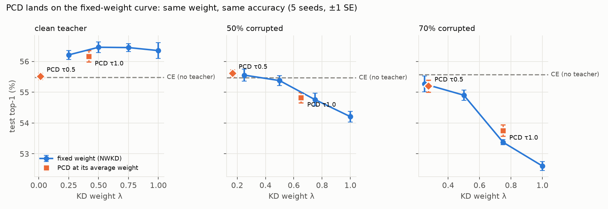

# MLR570 project: Priority-Constrained Descent for knowledge distillation

This is the research project for MLR570 (Advanced Machine Learning, American University of Sharjah).

It tests **Priority-Constrained Descent (PCD)** as a way to combine the two losses of knowledge distillation (KD): the task loss (cross-entropy on the labels, CE) and the distillation loss (KD, matching the teacher).
- PCD treats CE as the primary objective.
- It treats KD as a constraint: each step must make at least τ of progress on KD, and otherwise stays as close to the CE gradient as possible.

The experiments compare PCD with the usual fixed-weight sums and with the multi-objective rules from the KD literature: PCGrad, MGDA, DOT and DTO-KD. The comparison covers clean teachers, corrupted teachers, noisy labels, long-tailed data and several other stress tests on CIFAR-100 and CIFAR-10.

The survey paper that chose these baselines lives in a separate repository, `Battikhah/MLR570-survey`.

## Where the project stands (22 November 2026)

**Start with [`docs/project-story.md`](docs/project-story.md).** It defines every term, walks through decisions 0001–0006 with the evidence that triggered each one, and summarises the results.

- **Runs so far:** 786 screening runs (655 from the first weekend, 14–16 Nov, plus 131 from the extended window that is still running). Latest tables and figures: [`research/results/screen-2026-11-22/`](research/results/screen-2026-11-22/README.md).
- **Main result (VERIFIED, 5 seeds):** PCD's adaptive KD weight gives the same accuracy as a fixed weight of the same size, at every level of teacher corruption.
  - The fixed-weight control (NWKD) is PCD with the adaptive weight switched off, planned as the main control from the start (decision 0001).
  - The diagnostics show why: PCD's weight barely moves within a run, because the agreement between the CE and KD gradients is set by the teacher's error rate, which is fixed.
- **Under a bad teacher (VERIFIED, 5 seeds):** only a small KD weight is safe.
  - PCD τ0.5 stays at the no-teacher accuracy.
  - PCD τ1.0 ends 1.8 pp below it, because its weight grows as the teacher gets worse.
  - Standard KD and DOT end 14–15 pp below it.
- **With a good teacher (VERIFIED):** DOT and PCGrad beat PCD and every fixed weight by about 1.2–2 pp. Choosing the KD weight better cannot close that gap.
- **The pipeline reproduces the literature:** on CRD's ResNet32x4 → ResNet8x4 with the mdistiller protocol, our KD gives 73.05 against the published 73.33, and our DOT 74.87 against 75.12.
- **DTO-KD is not reported:** it scores below CE everywhere, which points to a problem in our implementation. It is under audit.
- **Running now ([decision 0006](docs/decisions/0006-why-pcd-ties-a-fixed-weight.md)):** a teacher that turns bad halfway through training, the one setting where an adaptive weight can differ from a fixed one, and more seeds for the per-sample reliability gate.



## Repository layout

| Path | Contents |
|---|---|
| `src/pcdkd/optim/` | The combiners. `pcd.py` is PCD (closed form for two objectives, QP for more). `combiners.py` holds the weighted sums and the shared EMA normalisation. `combiners_extra.py` holds MGDA, DTO-KD, DOT, PCGrad, and the per-layer PCD variants `pcdl` and `pcdlm`. |
| `src/pcdkd/losses/` | KD (with the T² factor, as in mdistiller), DKD, attention transfer, and the confidence gate |
| `src/pcdkd/models/` | CIFAR ResNets (`resnet_cifar.py`) and the CRD/mdistiller ResNets that load the published teachers (`resnet_md.py`) |
| `src/pcdkd/data/` | CIFAR loading, train/val splits, label noise, long-tail and low-data subsets, teacher corruption |
| `src/pcdkd/train/trainer.py` | One training run: per-objective gradients, combiner, SGD, checkpoints, diagnostics every 50 steps |
| `src/pcdkd/experiments/` | `suite.py` defines the families, arms, profiles and run order. `runner.py` trains teachers and students from a shared queue. `window.py` enforces the workstation's access hours. |
| `scripts/` | `run_suite.py` (list or run the suite), `analyze_suite.py` (report and CSV), `dashboard.py` (live progress page), `fetch_cifar.py`, `workstation/run_weekend.ps1` |
| `tests/` | Unit and integration tests. They run on CPU with synthetic data. |
| `docs/project-story.md` | **Read first.** Definitions, every decision and why it was made, the results, the pre-registered predictions checked, and the deviations from the plan |
| `docs/experiment-suite.md` | The full design: every family, its hypothesis, arms, protocol, cost and known limitations |
| `docs/decisions/` | Decision records 0001–0006, indexed in `docs/decisions/README.md`: research objective, queue revisions, per-layer PCD, extended access, the teacher-switch test |
| `docs/requirements/`, `docs/reviews/` | Assignment requirements taken from `Project Files/`; cross-agent review records |
| `research/results/` | Committed result snapshots: `screen-2026-11-16/` and `screen-2026-11-22/` (CSV, report, diagnostics, figures, and `tables.py`/`figures.py` that rebuild every number). Raw outputs stay on Google Drive. |
| `configs/`, `paper/` | Base experiment configs; survey-revision notes (the survey itself is in `MLR570-survey`) |
| `research/`, `refine-logs/`, `idea-stage/` | Notes, the pre-registered experiment plan (`refine-logs/EXPERIMENT_PLAN.md`), and the proposal |
| `literature/` | Source registry (`sources.yaml`) with verification notes. PDFs stay local. |
| `Project Files/` | Original course materials. Read-only. |
| `data/`, `outputs/` | Datasets and run outputs. Git-ignored. |

## Setup

Python 3.11 and [uv](https://docs.astral.sh/uv/).

```bash
uv sync --frozen
uv run pytest -q -m "not slow and not requires_data"   # CPU, synthetic data, a few minutes
uv run ruff check src scripts tests
```

CIFAR-10/100 (about 324 MB) is downloaded by `uv run python scripts/fetch_cifar.py --yes`. The literature-matched family `lit-p1` also needs CRD's published teachers. The commands and checksum are in [docs/experiment-suite.md](docs/experiment-suite.md#crd-teachers-lit-p1).

## Running experiments

```bash
uv run python scripts/run_suite.py list --profile screen               # sizes and cost per family
uv run python scripts/run_suite.py run --profile screen --dry-run --queue   # the run order, no training
uv run python scripts/run_suite.py run --profile screen --queue        # train (start 2-4 of these per GPU)
uv run python scripts/analyze_suite.py --out outputs/suite --profile screen
```

There are three profiles:
- **`smoke`:** synthetic data, 2 steps. The tests use it.
- **`screen`:** 60 epochs, with the seed counts in `PROFILES["screen"]["seed_overrides"]`. This is the profile that has been run.
- **`full`:** 240 epochs.

Each run is keyed by an ID such as `teacher-corruption/rho0.7/pcd_t1.0/s3`. Its `result.json` stores the full spec, the test and validation metrics, the diagnostics and the git commit. Finished runs are skipped. Interrupted runs resume from their last checkpoint.

**Run order.** `--queue` processes share one ordered list, and each takes the next unclaimed run. The order is `suite.WEEKEND_PLAN`: the follow-up blocks of decisions 0006 and 0005 first, then the earlier blocks of decisions 0002–0004, then everything else. Each teacher is trained just before its first student.

**Rule for new arms or seeds.** Add them at the end of a family's list so that no existing run ID or spec changes. The tests check the plan for typos and check that every run appears exactly once.

## Running on the AUS GPU workstation

The project runs on the ESB-1043 workstation (RTX 4500 Ada, Windows, DeepFreeze), reached over GlobalProtect and RDP.

**Access hours (UAE time):**
- Thursday 18:00 – Monday 08:00.
- From Wednesday 18 November until Monday 23 November 08:00, also every night 20:00 – 08:00.

The runner refuses to start outside these hours. Inside them, it pauses with a checkpoint about 20 minutes before the window closes, so everything is uploaded and you can log off by 08:00.

DeepFreeze wipes the local disk on every restart. The script keeps the results on Google Drive and restores them when a session starts after a wipe.

Once per wipe, in PowerShell:

```powershell
git clone https://github.com/Battikhah/MLR570-project "$env:LOCALAPPDATA\pcd-suite\code"
```

Each session:

```powershell
cd "$env:LOCALAPPDATA\pcd-suite\code\scripts\workstation"
powershell -ExecutionPolicy Bypass -File run_weekend.ps1 -Data U:\pcd-data
```

The script then does the following, in order:
1. Pulls the latest `main`.
2. Restores results from Drive if the disk was wiped.
3. Installs the CUDA build of torch and checks the GPU.
4. Runs the CPU tests.
5. Starts the dashboard at http://127.0.0.1:8765.
6. Starts 3 workers.
7. Copies results, checkpoints and logs to `My Drive/pcd-suite/` every 5 minutes.

`U:\pcd-data` survives DeepFreeze, so CIFAR and the CRD teachers are downloaded only once.

When you leave, keep the PowerShell window open and close the RDP window. Do not sign out, because signing out stops the run. After each window closes, start the script again at the next one; it continues where it stopped.

To analyse on a laptop:

```bash
rclone copy gdrive:pcd-suite/outputs <dir> --include "result.json"
uv run python scripts/analyze_suite.py --out <dir> --profile screen
```

## Rules for working here

`AGENTS.md` has the full rules; `CLAUDE.md` imports them for coding agents, and `orca.yaml` sets up Orca worktrees. The main ones:
- Never commit datasets, checkpoints, credentials or copyrighted PDFs.
- Never invent references or results.
- Label claims VERIFIED, INTERPRETATION or HYPOTHESIS.
- Every code change comes with tests.
- Downloads and GPU runs need approval.
