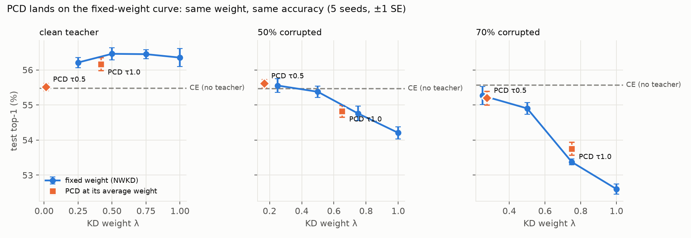
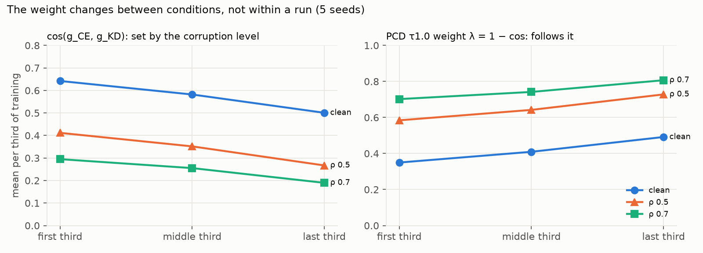
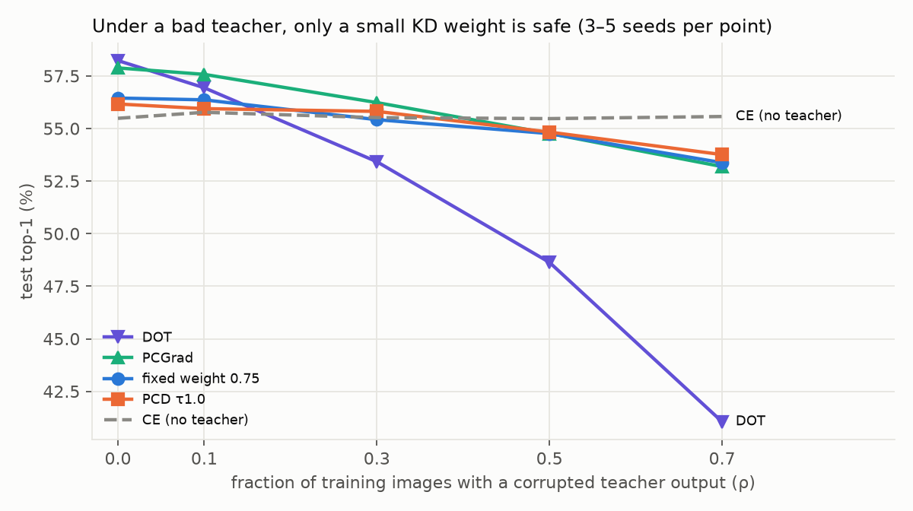
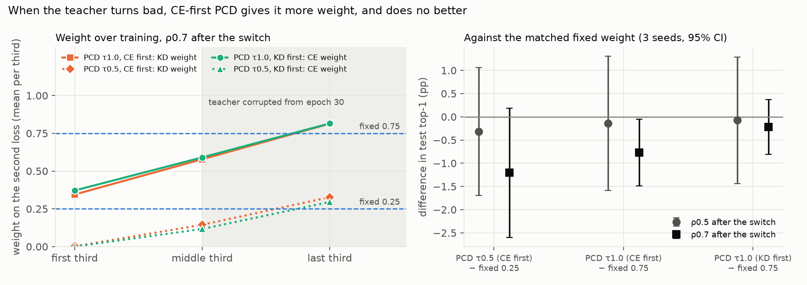

# The project's story: what we tested, what we changed, and why

This is the one document to read first. It explains every term, every decision record (0001–0006), the evidence that triggered each one, and what the results now say. Every number links back to a committed file that recomputes it.

- **Results:** [`research/results/screen-2026-11-22/`](../research/results/screen-2026-11-22/README.md) (final set, 839 runs), [`research/results/screen-2026-11-16/`](../research/results/screen-2026-11-16/README.md) (first weekend)
- **Design of every experiment:** [`docs/experiment-suite.md`](experiment-suite.md)
- **Decision records:** [`docs/decisions/`](decisions/README.md)
- **Status: 25 November 2026. The experiments are finished.** The workstation's last result reached Drive at 13:48 on 22 November, and access ended on 23 November. A Colab launcher (`scripts/colab/`, branch `Battikhah/colab`) can continue the queue, but no run needs it for the conclusion. Claims are labelled VERIFIED (read from the runs), INTERPRETATION (our reading) or HYPOTHESIS (untested), as `AGENTS.md` requires.

## 1. The question in one paragraph

Knowledge distillation (KD) trains a small student network on two losses at once: cross-entropy on the true labels (CE) and a loss that matches a large teacher's outputs (KD). Normally the two are added with a fixed weight. **Priority-Constrained Descent (PCD)** is a recent optimiser rule (Varam & AlHajri, TMLR 2026) that does not add them. It treats CE as the main objective and KD as a constraint: each step must make at least τ progress on KD, and otherwise stays as close to the CE direction as possible. PCD had never been tried on KD. We asked whether it trains better students than the usual fixed weight and the KD-specific rules from the literature, with a good teacher and with an unreliable one.

## 2. Definitions

### The losses and the basic recipe

| Term | Meaning |
|---|---|
| **CE** | Cross-entropy on the true labels. Also the name of the baseline that trains the student on CE only, without a teacher. |
| **KD** | The distillation loss: KL divergence between the softened teacher and student outputs at temperature T = 4, scaled by T² as in mdistiller. |
| **g_CE, g_KD** | The gradients of the two losses with respect to the student's weights, on one batch. |
| **cos(g_CE, g_KD)**, or **c** | How much the two gradients agree. 1 means they point the same way, 0 means they are unrelated, negative means they conflict. |
| **WKD λ** | Standard (Hinton) KD: the raw weighted sum (1−λ)·CE + λ·KD. `wkd_l0.9` is λ = 0.9. |

### PCD and the rules built from it

| Term | Meaning |
|---|---|
| **PCD τ** | Priority-Constrained Descent with threshold τ. Both gradients are first normalised by running averages of their sizes (EMA normalisation). The step is the CE direction, bent just enough to make at least τ progress on KD, then rescaled to the size of g_CE. |
| **The closed form** | For two objectives PCD is exactly a weighted sum: step = g̃_CE + μ·g̃_KD with **μ = max(0, τ − c)** (Cor. 4.6 of the PCD paper; checked against the official code to 4e-16, decision 0001). So the KD weight goes **up** when CE and KD agree **less**. |
| **λ_eff** | PCD's KD weight μ, averaged over the steps of a run. It is the number that lets PCD be compared with a fixed weight. |
| **active** | The share of steps where μ > 0, that is, where the constraint bends the step at all. |
| **NWKD λ** | "Normalised weighted KD": PCD with the adaptive weight switched off. It uses the same EMA normalisation and the same rescale to ‖g_CE‖, with a fixed λ. **It is not a published method.** It is the control that isolates PCD's one new idea, the adaptive weight, and was planned as the main control from the start (decision 0001). In the paper it should be called "PCD with a fixed λ". |
| **pcdrev τ** | PCD with the priority reversed: KD is the main objective and CE the constraint. Its weight is then the CE weight. |
| **pcdl τ** | Per-layer PCD (decision 0004): the same rule solved separately for each layer group, so each layer gets its own weight. |
| **pcdlm τ** | Per-layer PCD on DOT-style momentum buffers (decision 0004). CE and KD each keep their own running sum m ← 0.9·m + g, and the cosine is taken between the buffers instead of the raw gradients. |
| **g_ (gated)** | The original proposal's reliability gate: KD is applied only on samples where the teacher predicts the true label with confidence ≥ 0.8. `g_pcd_t0.5` is gated PCD. It is the only rule here that judges the teacher sample by sample. |

### Methods from the literature

| Term | Meaning |
|---|---|
| **DOT** | Distillation-Oriented Trainer (ICCV 2023). It keeps separate momentum for the CE and KD gradients, with a larger momentum for KD (δ = 0.075). It is the strongest optimiser-side KD method we compare against. |
| **PCGrad** | Gradient surgery from multi-task learning: when g_KD conflicts with g_CE, the conflicting part is projected away (`pcgrad1s`: one-sided, KD projected off CE). |
| **MGDA** | Multiple-gradient descent: the min-norm combination of the two gradients, which treats both losses equally. |
| **DTO-KD** | A 2026 KD-specific rule that balances the two losses symmetrically. Our implementation scores below CE everywhere, so it is under audit and not reported. |
| **DKD** | Decoupled KD (a loss-side method), used in the `multi-loss-dkd` family. |

### Experimental setup

| Term | Meaning |
|---|---|
| **Teacher corruption, ρ** | For a fixed, seeded share ρ of training images, the teacher's output is replaced by a confident wrong answer. ρ0.7 means 70% of images get a wrong teacher. The same map is used for every method with the same seed. |
| **Label noise** (`sym0.4`, `asym0.4`) | 40% of the student's training labels are flipped, uniformly (sym) or to a similar class (asym). The teacher stays clean. |
| **Family** | A group of runs testing one hypothesis, such as `teacher-corruption` or `label-noise`. All families, with their hypotheses, are in [`experiment-suite.md`](experiment-suite.md). |
| **Arm** | One method with fixed settings, such as `pcd_t1.0` or `nwkd_l0.5`. |
| **Run ID** | `family/condition/arm/seed`, for example `teacher-corruption/rho0.7/pcd_t1.0/s3`. It never changes, so a stopped run can resume. |
| **Profiles** | `screen` (60 epochs; what has run), `full` (240 epochs, the published protocol), `smoke` (tiny CPU runs for the tests). |
| **Pairs** | `core-p0`: our ResNet32 teacher → ResNet8 student. `core-p1`, `lit-p1`: ResNet32x4 → ResNet8x4. `lit-p1` uses CRD's published teacher and the mdistiller protocol, so its numbers can be compared with published tables. |
| **Paired difference** | Two arms with the same seeds, compared seed by seed. The interval after a difference is a 95% t-interval over seeds. |

## 3. Timeline: each decision, what triggered it, and why

### 2 November. Decision 0001: test PCD against its own fixed-weight version

**What we knew:** the submitted proposal asked whether reliability-gated PCD protects a student from an unreliable teacher. Reading the PCD paper and its code showed two things that changed the question:

1. For two objectives PCD is exactly a weighted sum with weight max(0, τ − c). So the only way it can beat a well-chosen fixed weight is through how that weight changes from step to step.
2. That weight **grows** when the teacher disagrees with the labels. The intuition "PCD protects the student from a bad teacher" runs opposite to its mechanism.

**What we decided:** the main comparison is PCD against NWKD, the same normalisation and rescale with a fixed, tuned λ. The plan was written down before any run, with hypotheses H0–H4 ([`research/experiment-plans/pcd-kd-conflict.md`](../research/experiment-plans/pcd-kd-conflict.md)). It predicted that PCD would not beat NWKD under corruption (H2) and would tie it with a clean teacher (H3). The refined proposal added the KD literature's own rules (DOT, DTO-KD, PCGrad, MGDA) and the literature-matched pair, and said in advance that "PCD's coefficient is batch-level and does not identify corrupted examples" ([`refine-logs/FINAL_PROPOSAL.md`](../refine-logs/FINAL_PROPOSAL.md)).

**Why it matters now:** the main result below is the answer to the question asked on 2 November, not a question invented after seeing the data.

### 11–13 November. The suite and the workstation

The experiments became one suite of families (`src/pcdkd/experiments/suite.py`), each testing a regime where PCD's mechanism predicts a difference: noisy labels, a corrupted teacher, loss scaling, temperature, long-tailed data, low data, several teachers, more than two losses. It runs on the university's GPU workstation (ESB-1043), which is available only at weekends and is wiped by DeepFreeze on every restart. So results sync to Google Drive, runs resume from checkpoints, and a guard stops the runner before the access window closes.

### 14 November. Decision 0002: one weekend left, so spend seeds where the paper needs them

**Trigger:** every result was single-seed, and one weekend remained. Finishing one seed of every family would leave the central comparisons unreplicated.

**Change:** the `screen` profile gives 5 seeds to teacher corruption, 3 to label noise and core-p0, and 2 to lit-p1, and the queue runs those first. `lit-p1` gained PCD τ2.0, because core-p0's validation split picked τ = 2.0 and lit-p1 has no validation split of its own.

### 14 November. Decision 0003: the effect is at high corruption, and single seeds are noise

**Trigger (first 291 runs):**
- Five CE runs with the same spec and seed spread from 54.82 to 56.15 (sd 0.46). Single-seed gaps under about 1.5 pp mean nothing.
- The big effect was at high corruption. From ρ0 to ρ0.7, DOT lost 17.1 pp and standard KD 15.6 pp, while PCD τ1.0 and NWKD 0.5 lost 1.9 pp each.
- DTO-KD was below CE almost everywhere.

**Change:** the extra seeds moved from ρ0.1/0.3, where the methods differ by less than the noise, to ρ0.5/0.7, where they differ by 15 pp. DTO-KD was moved to the back of the queue pending an audit.

### 15 November. Decision 0004: if PCD equals a fixed weight, try versions that cannot

**Trigger:** on the screen results, PCD behaved like NWKD at a matched weight. The closed form says why: a single weight that barely moves is a fixed weight.

**Change:** two variants that a single fixed weight cannot reproduce:
- `pcdl` gives each layer its own weight.
- `pcdlm` also computes the weight on momentum buffers, borrowing DOT's idea.

They were added as exploratory arms, labelled as post-hoc.

**Outcome (now 5 seeds):** `pcdl` changes nothing (λ_eff 0.421 against 0.417), because every layer sees the same cosine. `pcdlm` is the best PCD variant on a clean teacher (+1.05 [+0.29, +1.80] over PCD).

### 16 November. The first weekend's results (655 runs)

[`screen-2026-11-16/`](../research/results/screen-2026-11-16/README.md):
- **Under heavy corruption**, PCD τ0.5 stayed at the CE level while standard KD and DOT lost 15–17 pp.
- **NWKD 0.5 protected just as well.**
- **With a clean teacher**, PCD matched the tuned weighted sums and trailed DOT and PCGrad.

That left two holes:
- We had no fixed weight at the values PCD actually used (0.01–0.75).
- PCGrad, the strongest clean competitor, had only 1 seed under heavy corruption.

**Correction made on 22 Nov:** the 16 Nov summary said PCD "never drops meaningfully below CE". That is true for τ0.5 only. PCD τ1.0 is 1.81 pp [1.30, 2.32] below CE at ρ0.7 (5 seeds).

### 18 November. Decision 0005: extra access nights, spent on the deciding comparison

**Trigger:** the lab extended remote access until 23 November (nightly 20:00–08:00 plus the weekend).

**Change:**
- **Code:** the access-window guard learned the nightly windows.
- **New arms, in queue order:**
  1. Fixed weights NWKD 0.25 and 0.75 under teacher corruption. With the existing 0.5 and 1.0, these give a fixed-weight curve across the whole range PCD uses.
  2. PCGrad to 5 seeds.
  3. PCDLM on the clean benchmarks and under label noise.

**Reranked on 21 Nov:** no run had started until Saturday night, leaving about 35 GPU hours. The queue was reordered most-important-first: the two headline questions, then hypotheses never run, then extra seeds.

### 22 November. The deciding result, and decision 0006

**Result (5 seeds):** PCD lands exactly on the fixed-weight curve (Figure 1 below). At every corruption level, PCD and the fixed weight nearest its average differ by −0.3 to +0.4 pp, and every interval includes 0. The one significant gap goes against PCD.

**Trigger for 0006:** the diagnostics explain the tie. PCD's weight barely moves within a run (Figure 2). Two questions follow that we could not yet answer with data, and that a reader will ask:

1. **Would judging the teacher per sample fix what the batch cosine misses?**
   - The gated arms do that, and gated PCD scored 55.61 at ρ0.7, the CE level and the best KD result there.
   - But it had 1 seed at ρ0.5/0.7.
2. **Does the adaptive weight help when the cosine does change within a run?**
   - That is the one setting where theory says it can differ from a fixed weight, and no family produced it.

**Change:**
- Gated PCD and gated NWKD get 4 more seeds at ρ0.5/0.7.
- A new family, `teacher-switch`, has a teacher that is clean for the first half of training and then corrupted at ρ0.5 or ρ0.7.
- The switch runs fixed weights 0.25/0.75, CE-first PCD (whose weight should move the wrong way when the teacher turns bad) and KD-first PCD (whose CE weight should move the right way).
- Both blocks run first in the remaining window (about 7 GPU hours).

### 22 November, afternoon. The answer to decision 0006, and the end of the runs

**The gate (5 seeds):** judging the teacher per sample works. It adds 1.3–1.9 pp to a fixed weight of 1.0 at ρ0.5/0.7. Gated PCD ties an ungated fixed weight of its size (its KD weight averages 0.12–0.19), so the gate's gain does not need PCD.

**The teacher switch (3 seeds):** CE-first PCD raised its KD weight when the teacher turned bad (0.35 → 0.81 for τ1.0 at ρ0.7), as 0006 predicted, and lost to the matched fixed weight: −0.77 [−1.49, −0.06] pp. KD-first PCD moved its CE weight the right way but only tied the fixed weight (τ1.0) or fell far below CE (τ0.5).

**Outcome:** 0006's rule for this case was: "if it ties here too, the paper reports PCD as a principled way to bound the KD weight, not as an adaptive combiner." It tied or lost. The workstation stopped uploading at 13:48 the same day, with 37 of the 60 switch runs done, and the access window closed before it came back.

## 4. What the results say now

The full tables, with every interval, are in [`screen-2026-11-22/README.md`](../research/results/screen-2026-11-22/README.md).



**1. PCD's adaptive weight gives the same accuracy as a fixed weight of the same size (VERIFIED, 5 seeds).**
- PCD τ1.0 against NWKD 0.75: −0.28 [−1.01, +0.45] clean, +0.07 [−0.90, +1.04] at ρ0.5, +0.38 [−0.20, +0.97] at ρ0.7.
- PCD τ0.5 against NWKD 0.25: −0.69 [−1.27, −0.11] clean (PCD worse), then +0.06 and −0.07 at ρ0.5 and ρ0.7, both intervals spanning 0.



**2. Why: PCD's weight is set by the experiment's conditions, not by the training step (VERIFIED diagnostics, INTERPRETATION of the cause).**
- **The cosine within a run is steady.** Its step-to-step sd is 0.08–0.10. It drifts only slowly, from 0.64 to 0.50 over training with a clean teacher.
- **So PCD τ1.0's weight is steady too.** It averages 0.42 with a clean teacher and 0.75 at ρ0.7, with a within-run sd of about 0.1.
- **PCD's update points almost the same way as the NWKD update:** cosine 0.98–0.99.
- **The cause is that nothing setting the cosine changes during a run.** The teacher is frozen and the corruption map is fixed, so every batch of 64 has about the same share of disagreeing samples and gives about the same cosine.
- **Cor. 4.6 predicts exactly this.** With a steady c, PCD is a fixed weight.



**3. Under a bad teacher, only a small KD weight is safe, and PCD's weight moves the wrong way (VERIFIED, 5 seeds).**
- **At ρ0.7, accuracy falls steadily as the fixed weight grows:** 55.27 at λ0.25, 54.90, 53.37, and 52.60 at λ1.0. CE alone gets 55.57.
- **PCD reads lower agreement as a reason to add KD,** so its weight rises from 0.42 to 0.75 as the teacher gets worse. That was the prediction of decision 0001.
- **PCD τ1.0 ends 1.81 pp below CE. PCD τ0.5 stays at the CE level** (−0.37 [−0.86, +0.11]) because it barely uses KD.
- **The conflict-aware methods collapse:** PCGrad falls 2.38 pp below CE and DOT 14.5 pp.

**4. With a good teacher, the best methods win by something other than the KD weight (VERIFIED; the mechanism is a HYPOTHESIS).**
- **No fixed weight from 0.25 to 1.0 passes 56.5 on the clean teacher.**
- **PCGrad gets 57.88 and DOT 58.23.** That is +1.71 and +2.06 over PCD τ1.0, 5 seeds.
- **So their gain cannot come from choosing the weight well,** and no rule that only chooses a weight, PCD included, can match it.
- **HYPOTHESIS:** the gain comes from acting on the optimiser's momentum or on gradient directions. PCDLM, which moves PCD's rule onto momentum buffers, closes about half the gap (57.21).

**5. PCD's priority setting does matter (VERIFIED, 3 seeds).**
- **With noisy labels, putting the teacher first beats putting CE first:** +1.76 pp at sym0.4 and +5.66 pp at asym0.4. It ties the tuned heavy fixed weights.
- **With a corrupted teacher, putting the teacher first is a disaster:** −11.1 pp against CE at ρ0.7.
- **So PCD protects whichever signal you put first.** That is useful when you know which signal is unreliable, but a fixed weight chosen with the same knowledge does as well.

**6. The per-sample gate helps, but not through PCD (VERIFIED, 5 seeds).**
- **The gate adds 1.29 [+0.82, +1.76] pp to NWKD 1.0 at ρ0.5 and 1.89 [+1.41, +2.36] at ρ0.7.**
- **Gated PCD τ0.5 against an ungated fixed 0.25:** +0.14 and +0.24, both intervals spanning 0. Gated PCD beats gated NWKD 1.0 at ρ0.7 (+1.02 [+0.28, +1.76]) only because its weight is far smaller.



**7. When the teacher turns bad during training, PCD's weight moves the wrong way and PCD does no better (VERIFIED, 3 seeds).**
- **This is the setting built to favour an adaptive weight,** because the cosine changes within the run: from 0.65 to 0.18 at ρ0.7.
- **CE-first PCD τ1.0's KD weight rises from 0.35 to 0.81** as the teacher gets worse. At ρ0.7 it loses to fixed 0.75 (−0.77 [−1.49, −0.06]), although its average weight is lower (0.58).
- **KD-first PCD raises its CE weight, the right way,** but τ1.0 only ties the fixed weight (−0.22 [−0.81, +0.37]) and τ0.5 ends 5.31 pp below CE at ρ0.7.
- **No arm beats CE meaningfully.** The best is fixed 0.25: +0.27 and +0.03.

**8. The pipeline is trustworthy (VERIFIED).**
- **lit-p1 reproduces the published mdistiller numbers:** KD 73.05 against 73.33 published, DOT 74.87 against 75.12.
- **Every arm shares seeds, data order and corruption maps,** so all comparisons are paired.

### What this means for the paper (INTERPRETATION)

- **PCD is not a better way to combine CE and KD.** The claim "PCD beats fixed weights" is ruled out.
- **The supported claims are about mechanism:**
  - On standard KD benchmarks PCD reduces to a fixed weight, because the CE–KD agreement does not change within a run.
  - Its weight rises with teacher–label disagreement, which is wrong for a corrupted teacher and right for noisy labels.
  - Robustness to a bad teacher comes from keeping the KD weight small, not from detecting conflict.
- **Neither limit could be lifted.** A per-sample check helps, but PCD adds nothing on top of it. A teacher that changes during training makes PCD's weight move, and in the wrong direction. See 6 and 7 above.

## 5. Predictions made before the runs, checked

| Pre-registered hypothesis (2 Nov) | Result |
|---|---|
| H0: the CE–KD cosine falls under corruption and PCD's constraint is often active | Holds: 0.575 → 0.428 at ρ0.3; τ1.0 active on 100% of steps |
| H1: PCD's weight rises under corruption | Holds: 0.42 → 0.57 (ρ0.3) → 0.75 (ρ0.7) |
| H2: under 30% corruption PCD is not more accurate than tuned NWKD | Holds: +0.13, 90% interval [−0.17, +0.44] |
| H3: clean teacher, PCD within ±0.5 pp of tuned NWKD | Not shown: −0.29, 90% interval [−0.80, +0.22] with 5 seeds (the plan assumed 10) |
| H4: gated PCD within ±0.5 pp of gated NWKD at 30% corruption | Not shown: −0.50, 90% interval [−1.51, +0.51] with 3 seeds |
| Non-claim in the proposal: PCD's batch-level weight cannot pick out corrupted samples | Holds. The per-sample gate is worth 1.3–1.9 pp to a fixed weight; PCD's batch weight adds nothing on top of it (decision 0006) |

## 6. Where we departed from the plan, and why

These deviations have to be reported in the paper:

| Planned (2 Nov) | Done | Why |
|---|---|---|
| 240-epoch runs, 10 paired seeds, Holm-corrected confirmatory tests | 60-epoch screening runs, 2–5 seeds, intervals without correction | Weekend-only GPU access. The screen profile was meant to find where to spend a full run, and the access window ran out first (decisions 0002–0005). |
| SGD without momentum | SGD momentum 0.9 | The suite follows the mdistiller CIFAR-100 protocol (`experiment-suite.md`, Protocol), which is what lets lit-p1 be checked against published tables. The reason for the switch was not written down when the suite was built (11 Nov). Momentum-off is kept as an ablation (`pcd-ablations`). |
| τ ∈ {0.05, 0.1, 0.3}; corruption 10% and 30% | τ from 0.1 to 2.0; corruption from 0% to 70% | Set when the suite was built; the reason was not recorded. The results justify it after the fact: τ = 0.1 behaves like CE (decision 0002), and methods only separate from the noise above 30% corruption (decision 0003). |
| DTO-KD as a main baseline | Held back | Its results sit below CE everywhere, which points to an implementation problem (decisions 0003, 0005). |
| Fixed arm list | Post-hoc arms: pcdl and pcdlm (0004), matched fixed weights (0005), teacher-switch (0006) | Each was added in response to a result, and is labelled exploratory. No existing run ID or setting was changed, which the tests check. |

## 7. Still open

- **Teacher-switch seeds 3–4** (23 runs) were not run. Only one of the switch comparisons excludes zero with 3 seeds. `scripts/colab/` can run them.
- **A gated fixed weight near 0.2,** the exactly matched control for gated PCD, was never queued.
- **Second seeds** for the single-seed leads, which access ended before reaching: temperature robustness (PCD's spread over T was 0.4 pp, against WKD's 5.7), the PCD ablations, and loss scaling.
- **The DTO-KD audit,** against the paper's equations and step size.
- **A cross-agent review** of decisions 0005 and 0006, which `AGENTS.md` requires for substantive changes.

## 8. How to check any number here

```bash
# the tables in the results README, from the committed CSVs (standard library only)
python research/results/screen-2026-11-22/tables.py
# the figures (matplotlib only for this command)
uv run --with matplotlib python research/results/screen-2026-11-22/figures.py
# regenerate the CSVs from the raw results on Google Drive
rclone copy gdrive:pcd-suite/outputs/screen <dir>/screen --include result.json --fast-list
uv run python scripts/analyze_suite.py --out <dir> --profile screen
python research/results/screen-2026-11-22/tables.py --extract <dir>/screen
```
