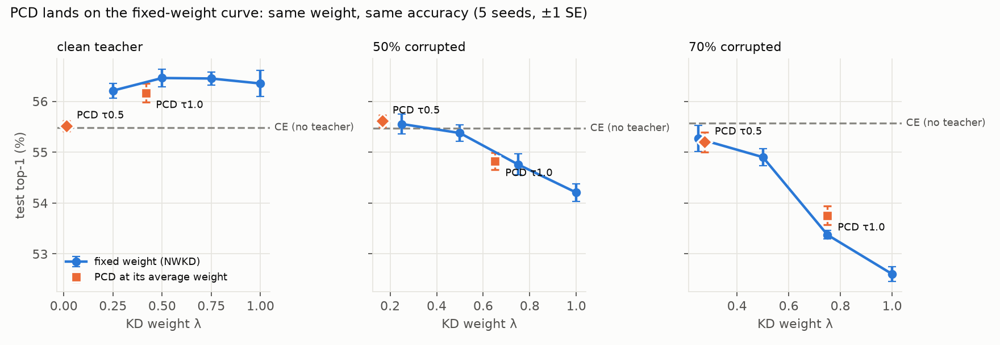
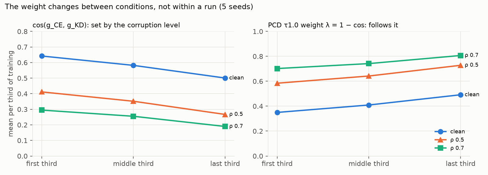
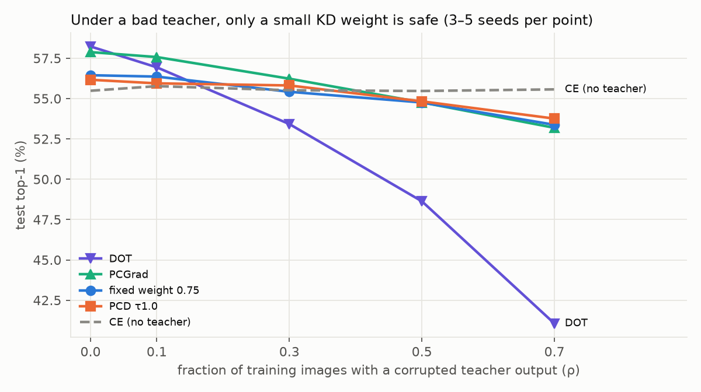
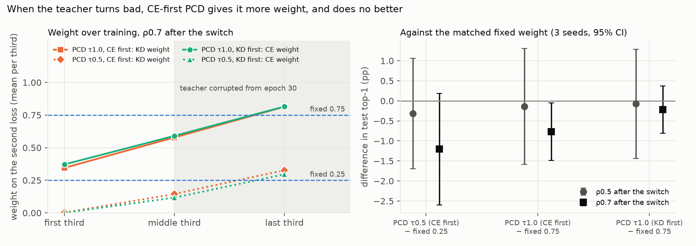

# Screen results, final set (last run 2026-11-22, 13:48 UAE)

This is the final set of screening runs: 839 in all. It follows `../screen-2026-11-16/` (655 runs) and adds the 184 runs of the extended access window (decisions 0005 and 0006). The workstation stopped uploading at 13:48 on 22 Nov, and the logs on Drive don't say why. Access ended on 23 Nov at 08:00, so no further runs came in. 23 of the 60 teacher-switch runs were never run (seed 4 of every arm, and seed 3 of every arm but one). A first version of this snapshot, taken at 10:08 on 22 Nov with 786 runs, is in the git history. For the full story of why each of these experiments exists, read [`docs/project-story.md`](../../../docs/project-story.md).

## What is in this folder

| File | What it is | How it was made |
|---|---|---|
| `runs.csv` | One row per finished student run, 839 rows | `scripts/analyze_suite.py --profile screen` on the `result.json` files copied from `gdrive:pcd-suite/outputs/screen/` on 25 Nov (nothing on Drive is newer than 13:48 on 22 Nov) |
| `REPORT.md` | The analysis script's report: per-cell detail and its "where does PCD win?" table | same command |
| `diagnostics.csv` | Per-run training diagnostics of the PCD arms: CE–KD cosine, PCD's weight λ_eff, their spread, λ_eff by thirds of training, active rate, and how close PCD's step is to the NWKD and CE steps | `python tables.py --extract <dir>` |
| `tables.py` | Prints every table below from the two CSVs (standard library only) | `python research/results/screen-2026-11-22/tables.py` |
| `figures.py`, `figures/` | The four figures below | `uv run --with matplotlib python research/results/screen-2026-11-22/figures.py` |

**Rules for reading these numbers:**
- All runs are screening runs: 60 epochs (240 for `lit-p1`), CIFAR-100, test top-1 in %.
- Identical CE runs differ by about 0.5 pp (sd) from GPU nondeterminism (decision 0003). Single-seed gaps under about 1.5 pp carry no information.
- Intervals are 95% t-intervals on seed-paired differences. Every arm in a family uses the same seeds, data order and corruption map, so the pairing is exact. There is no multiplicity correction unless stated.
- Labels follow `AGENTS.md`: **VERIFIED** means read from these runs; **INTERPRETATION** is our reading of them; **HYPOTHESIS** is untested.

## Short version

1. **VERIFIED (5 seeds):** PCD's adaptive weight gives the same accuracy as a fixed weight of the same size, at every corruption level. Figure 1.
2. **VERIFIED (diagnostics):** that is because PCD's weight barely changes within a run. It changes between conditions, because the CE–KD gradient cosine is set by how often the teacher disagrees with the labels. Figure 2.
3. **VERIFIED (5 seeds):** with a corrupted teacher, accuracy falls as the KD weight grows, for every method. PCD's weight grows with corruption, which is the wrong direction for this stressor. Only a small weight (PCD τ0.5, NWKD 0.25) stays at the CE level. Figure 3.
4. **VERIFIED:** with a good teacher, DOT and PCGrad beat every weighted sum, PCD included, by 1.2–2 pp. No fixed weight from 0.25 to 1.0 gets past 56.5 on teacher-corruption ρ0, so their gain does not come from the weight's size.
5. **VERIFIED (3 seeds):** with noisy labels, putting KD first (`pcdrev`) beats putting CE first, and matches the tuned fixed weights. DOT is best everywhere.
6. **VERIFIED (5 seeds):** judging the teacher per sample (the gate) helps a fixed weight by 1.3–1.9 pp under heavy corruption. Gated PCD only ties an ungated fixed weight of its size.
7. **VERIFIED (3 seeds):** when the teacher turns bad halfway through training, CE-first PCD raises the KD weight (0.35 → 0.81 for τ1.0 at ρ0.7). It ties or loses against the matched fixed weight: −0.77 [−1.49, −0.06] pp for τ1.0 at ρ0.7. Figure 4.

**Conclusion:** PCD's adaptive weight never beat a fixed weight of the same size: not with a clean teacher, not under constant corruption, not with the gate, and not when the teacher changes during training. That last setting is the one built to favour an adaptive weight, and there PCD's batch-level rule moved the weight the wrong way.

## Figure 1: PCD sits on the fixed-weight curve

PCD is placed at its average λ_eff in each condition (from `diagnostics.csv`). Paired differences against the fixed weight nearest that average:

| Comparison | ρ0 | ρ0.5 | ρ0.7 |
|---|---|---|---|
| PCD τ0.5 − NWKD 0.25 | −0.69 [−1.27, −0.11] | +0.06 [−0.52, +0.64] | −0.07 [−1.18, +1.05] |
| PCD τ1.0 − NWKD 0.75 | −0.28 [−1.01, +0.45] | +0.07 [−0.90, +1.04] | +0.38 [−0.20, +0.97] |

All n = 5. At ρ0.1 and ρ0.3 (3 seeds for PCD) the gaps are between −0.87 and +0.37; see `tables.py`. The one significant gap goes against PCD: with a clean teacher, τ0.5 uses almost no KD (λ_eff 0.01) and so loses what KD gives.

## Figure 2: the weight moves between conditions, not within a run

For two objectives PCD's closed form is λ = max(0, τ − c), where c is the cosine between the normalised CE and KD gradients (Cor. 4.6 of the PCD paper). PCD τ1.0, 5 seeds:

| Condition | Mean cos | Step-to-step sd of cos | λ_eff | λ_eff sd within a run | λ_eff by thirds | cos(PCD step, NWKD step) |
|---|---|---|---|---|---|---|
| clean teacher | 0.575 | 0.084 | 0.417 | 0.116 | 0.35 / 0.41 / 0.49 | 0.978 |
| ρ0.5 | 0.343 | 0.097 | 0.651 | 0.106 | 0.58 / 0.64 / 0.73 | 0.989 |
| ρ0.7 | 0.247 | 0.092 | 0.750 | 0.094 | 0.70 / 0.74 / 0.81 | 0.994 |

**INTERPRETATION:**
- The teacher is frozen and the corruption map is fixed for a run, so the share of samples where teacher and label disagree is constant. Each batch of 64 averages over that share, so every batch gives about the same cosine.
- PCD's EMA normalisation removes the gradient-size changes on purpose, which leaves only this steady angle.
- The slow upward drift comes from the student fitting the easy samples first: the remaining CE gradient comes more from the hard ones, where the teacher disagrees more.
- A rule that sees one cosine per batch cannot tell which samples are wrong. The project's proposal listed this as a non-claim before any run (`refine-logs/FINAL_PROPOSAL.md`).

## Figure 3: under a bad teacher only a small weight is safe

| Method | ρ0 | ρ0.1 | ρ0.3 | ρ0.5 | ρ0.7 |
|---|---|---|---|---|---|
| CE (no teacher) | 55.48 | 55.77 | 55.52 | 55.47 | 55.57 |
| NWKD 0.25 | 56.21 | 56.14 | 55.75 | 55.55 | 55.27 |
| NWKD 0.5 | 56.46 | 56.10 | 55.68 | 55.38 | 54.90 |
| NWKD 0.75 | 56.45 | 56.36 | 55.42 | 54.76 | 53.37 |
| NWKD 1.0 | 56.35 | 56.01 | 55.29 | 54.21 | 52.60 |
| PCD τ0.5 | 55.52 | 55.31 | 55.83 | 55.61 | 55.20 |
| PCD τ1.0 | 56.17 | 55.94 | 55.81 | 54.83 | 53.76 |
| PCDL τ1.0 | 56.41 | – | – | 54.96 | 53.12 |
| PCDLM τ1.0 | 57.21 | – | – | 55.42 | 53.11 |
| PCD, KD first (pcdrev τ0.5) | 56.11 | 54.79 | 52.29 | 48.84 | 44.47 |
| PCGrad | 57.88 | 57.57 | 56.23 | 54.76 | 53.19 |
| WKD 0.9 (standard KD) | 56.34 | 54.89 | 51.65 | 47.85 | 41.62 |
| DOT | 58.23 | 56.94 | 53.42 | 48.63 | 41.05 |

5 seeds at ρ0, 0.5 and 0.7; 3 seeds at ρ0.1 and 0.3 (5 for NWKD 0.25/0.75 and PCGrad). The full table, with the gated arms and DTO-KD, is printed by `tables.py`.

**VERIFIED, paired over 5 seeds at ρ0.7:**
- PCD τ1.0 − CE: −1.81 [−2.32, −1.30]. PCD τ1.0 does lose to CE; the 16 Nov summary's "PCD never drops meaningfully below CE" holds for τ0.5 only (−0.37 [−0.86, +0.11]).
- PCGrad − CE: −2.38 [−3.37, −1.39]. PCGrad − PCD τ1.0: −0.57 [−1.61, +0.47].
- DOT − PCD τ1.0: −12.70 [−13.76, −11.65].
- KD-first PCD − CE: −11.10 [−11.35, −10.84]. With KD in charge, CE only gets τ-progress, so the student follows the bad teacher.

**With a good teacher (ρ0, 5 seeds):** PCGrad − PCD τ1.0 = +1.71 [+0.87, +2.55]; DOT − PCD τ1.0 = +2.06 [+1.43, +2.70].

## The per-sample gate under heavy corruption (decision 0006)

The gate keeps the KD loss only on samples where the teacher's top class matches the label and its confidence is at least 0.8 (`g_` arms). Paired differences in pp, 5 seeds:

| Comparison | ρ0.5 | ρ0.7 |
|---|---|---|
| Gated NWKD 1.0 − NWKD 1.0 (what the gate adds) | +1.29 [+0.82, +1.76] | +1.89 [+1.41, +2.36] |
| Gated PCD τ0.5 − PCD τ0.5 | +0.08 [−0.46, +0.62] | +0.31 [−0.66, +1.29] |
| Gated PCD τ0.5 − gated NWKD 1.0 | +0.20 [−0.29, +0.70] | +1.02 [+0.28, +1.76] |
| Gated PCD τ0.5 − NWKD 0.25 | +0.14 [−0.56, +0.85] | +0.24 [−0.79, +1.28] |
| Gated PCD τ0.5 − CE | +0.23 [+0.06, +0.39] | −0.06 [−0.85, +0.73] |

**INTERPRETATION:**
- Judging the teacher per sample works: it is worth 1.3–1.9 pp to a fixed weight of 1.0.
- Gated PCD's win over gated NWKD 1.0 at ρ0.7 comes from the size of the weight, not from adapting it. Gated PCD's average KD weight is 0.12 at ρ0.5 and 0.19 at ρ0.7 (`diagnostics.csv`). Against an ungated fixed 0.25 it ties.
- No gated fixed weight near 0.2 was run, so the exactly matched control is missing.

## Figure 4: a teacher that turns bad during training (decision 0006)

`teacher-switch`: the teacher is clean for the first 30 of 60 epochs, then corrupted at ρ0.5 or ρ0.7, using the same per-sample map as `teacher-corruption`. This is the one setting where the cosine changes within a run, so an adaptive weight can differ from a fixed one. CE ignores the teacher, so the `teacher-corruption` CE runs (same data and seeds) are the reference. 3 seeds (4 for NWKD 0.25 at ρ0.5); seeds 3–4 were not run.

Weight on the second loss, by thirds of training (the switch falls in the middle third):

| Arm | Weight that adapts | ρ0.5 | ρ0.7 |
|---|---|---|---|
| PCD τ0.5, CE first | KD weight | 0.002 → 0.09 → 0.24 | 0.002 → 0.15 → 0.33 |
| PCD τ1.0, CE first | KD weight | 0.35 → 0.53 → 0.73 | 0.35 → 0.58 → 0.81 |
| PCD τ0.5, KD first | CE weight | 0.001 → 0.08 → 0.23 | 0.001 → 0.12 → 0.30 |
| PCD τ1.0, KD first | CE weight | 0.37 → 0.54 → 0.74 | 0.37 → 0.59 → 0.82 |

Paired differences in test top-1 (pp), 3 seeds:

| Comparison | ρ0.5 | ρ0.7 |
|---|---|---|
| PCD τ0.5 (CE first) − NWKD 0.25 | −0.32 [−1.69, +1.06] | −1.21 [−2.60, +0.19] |
| PCD τ1.0 (CE first) − NWKD 0.75 | −0.14 [−1.58, +1.30] | **−0.77 [−1.49, −0.06]** |
| PCD τ1.0 (KD first) − NWKD 0.75 | −0.07 [−1.44, +1.29] | −0.22 [−0.81, +0.37] |
| PCD τ0.5 (KD first) − CE | −2.75 [−3.98, −1.53] | −5.31 [−6.06, −4.56] |
| NWKD 0.25 − CE (best arm) | +0.27 [−0.66, +1.20] | +0.03 [−0.43, +0.48] |
| PCD τ1.0 (CE first) − CE | −0.15 [−0.52, +0.22] | −1.46 [−2.32, −0.61] |

**VERIFIED:**
- Decision 0006 predicted that CE-first PCD would raise its KD weight when the teacher turned bad, which is the wrong way. It did, at both τ and both ρ.
- At ρ0.7, PCD τ1.0 averages a lower KD weight than the fixed 0.75 (0.58 against 0.75) and still loses to it. Its weight is highest in the last third, when the teacher is worst.
- KD-first PCD raises its CE weight, which is the right way, but this doesn't help. At τ0.5 the CE weight stays far too small, and the arm ends 2.7–5.3 pp below CE. At τ1.0 it only ties the fixed weight.
- No arm beats CE by a meaningful amount.

**INTERPRETATION:** the cosine follows the teacher's quality, but λ = max(0, τ − c) maps a lower cosine to a larger KD weight. That is correct when a lower cosine means the losses disagree about something the student should learn, and wrong when it means the teacher is wrong. Decision 0006's outcome rule applies: *"If it ties here too: … the paper then reports PCD as a principled way to bound the KD weight, not as an adaptive combiner."*

## The per-layer variants (decision 0004)

| Comparison (5 seeds) | ρ0 | ρ0.5 | ρ0.7 |
|---|---|---|---|
| PCDL τ1.0 − PCD τ1.0 | +0.25 [−0.17, +0.66] | +0.13 [−0.34, +0.60] | −0.64 [−1.61, +0.34] |
| PCDLM τ1.0 − PCD τ1.0 | +1.05 [+0.29, +1.80] | +0.59 [−0.20, +1.38] | −0.65 [−1.13, −0.17] |
| PCDLM τ1.0 − NWKD 0.75 | +0.77 [+0.01, +1.52] | +0.66 [−0.19, +1.50] | −0.26 [−0.65, +0.12] |
| PCDLM τ1.0 − NWKD 1.0 | +0.86 [+0.18, +1.55] | +1.21 [+0.18, +2.24] | +0.51 [−0.02, +1.04] |

- **PCDL (per-layer PCD) changes nothing:** its average weight is 0.421 against PCD's 0.417 on the clean teacher. Every layer sees about the same cosine.
- **PCDLM (per-layer, on separate momentum buffers)** is the only variant that beats a fixed weight of similar size, and only just: +0.77 [+0.01, +1.52] against NWKD 0.75 on the clean teacher. Its weight (0.65 clean, 0.92 at ρ0.7) sits between 0.75 and 1.0, so both are shown. On core-p0 (3 seeds) it gets 57.40, +0.45 [−1.12, +2.02] over PCD and −0.74 [−2.25, +0.77] behind DOT.

## Label noise (clean teacher, noisy student labels), 3 seeds

| Method | sym0.0 | sym0.4 | sym0.8 | asym0.4 |
|---|---|---|---|---|
| CE | 55.47 | 44.89 | 13.34 | 36.69 |
| NWKD 1.0 | 56.47 | 55.27 | 52.87 | 52.95 |
| NWKD 4.0 | 55.93 | 56.18 | 56.70 | 56.01 |
| WKD 0.9 | 56.24 | 55.96 | 55.77 | 56.03 |
| PCD τ1.0 (CE first) | 56.47 | 54.55 | 54.82 | 50.21 |
| PCD τ0.5, KD first (pcdrev) | 56.06 | 56.31 | 54.74 | 55.87 |
| DOT | 58.18 | 58.40 | 58.03 | 58.22 |

- **KD first − CE first:** +1.76 [+0.89, +2.63] at sym0.4 and +5.66 [+4.11, +7.21] at asym0.4.
- **KD first against NWKD 4.0:** +0.12 [−0.87, +1.11] at sym0.4, −1.96 [−3.63, −0.29] at sym0.8.
- **DOT against KD-first PCD:** +2.10 to +3.29, significant at every level shown.

**INTERPRETATION:** PCD's priority setting says which signal is protected. That helps when you know which signal is unreliable, but a heavy fixed weight on the teacher does as well, and DOT does better.

## Clean benchmarks

| Setting | CE | Best fixed weight | PCD | PCDLM | PCGrad | DOT |
|---|---|---|---|---|---|---|
| core-p0 (ResNet32 → ResNet8, 3 seeds) | 55.44 | WKD 0.5: 56.82 | τ1.0: 56.95 | τ1.0: 57.40 | 58.30 | 58.14 |
| lit-p1 (CRD ResNet32x4 → ResNet8x4, 2 seeds) | 72.16 | NWKD 1.0: 73.62 | τ2.0: 73.20 | τ1.0: 73.49 (1 seed) | 74.43 | 74.87 |
| core-p1 (1 seed) | 70.50 | WKD 0.5: 71.07 | τ2.0: 70.83 | – | 71.53 | 71.44 |

- core-p0: PCD τ1.0 − NWKD 1.0 = +0.33 [−0.47, +1.14]; DOT − PCD τ1.0 = +1.19 [+0.74, +1.65]; PCGrad − PCD τ1.0 = +1.35 [+0.30, +2.40].
- lit-p1 reproduces the published protocol (VERIFIED against mdistiller's tables): KD 73.05 here against 73.33 published, DOT 74.87 against 75.12.
- `REPORT.md`'s headline table picks each method's configuration on validation. In every cell with at least 2 seeds, the best PCD configuration is below the best baseline.

## Pre-registered hypotheses

From `research/experiment-plans/pcd-kd-conflict.md` (decision 0001, written 2 Nov before any run). Equivalence uses the plan's 90% TOST interval and δ = 0.5 pp.

| Hypothesis | What it said | Result |
|---|---|---|
| H0 | The CE–KD cosine is lower under corruption, and PCD's constraint is active often | **Holds.** Cosine 0.575 → 0.428 from ρ0 to ρ0.3; active on 100% of steps for τ1.0, 23% → 71% for τ0.5. |
| H1 | PCD's weight is larger under corruption | **Holds.** τ1.0: 0.42 → 0.57 at ρ0.3 and 0.75 at ρ0.7. This was a prediction from the closed form, not a finding. |
| H2 | Under 30% corruption, PCD is not more accurate than tuned NWKD | **Holds.** PCD τ1.0 − NWKD 0.5: +0.13, 90% interval [−0.17, +0.44] (3 seeds). |
| H3 | With a clean teacher, PCD and tuned NWKD are within 0.5 pp | **Not shown.** PCD τ1.0 − NWKD 0.5: −0.29, 90% interval [−0.80, +0.22] (5 seeds). The mean gap is small, but 5 seeds are too few to place the interval inside ±0.5. |
| H4 | With the gate, PCD and NWKD are within 0.5 pp at 30% corruption | **Not shown.** Gated PCD τ0.5 − gated NWKD 1.0: −0.50, 90% interval [−1.51, +0.51] (3 seeds). |

## Not reportable yet

- **DTO-KD** is below CE in every family (for example 50.80 vs 55.48 at ρ0, 2 seeds). That points to an implementation problem. It stays out of every claim until audited (decision 0005).
- **Single-seed families** (temperature, pcd-ablations, capacity-gap, long-tail, multi-loss-dkd, core-p1) are leads only. Their second seeds were queued but not reached before access ended.
- **Teacher-switch seeds 3–4** were not run. The 3-seed intervals above are wide; only the PCD τ1.0 result at ρ0.7 excludes zero.
- **A gated fixed weight near 0.2**, the matched control for gated PCD, was never in the queue.
